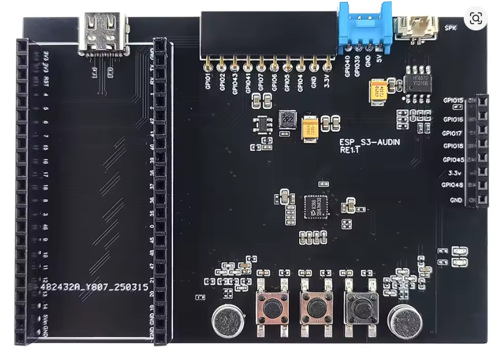

# ESP S3-AUDIN Home Assistant Voice Assistant

A custom ESPHome-based voice assistant built around the ESP32-S3-AUDIN development board, integrated with Home Assistant Assist.

The project combines local wake-word detection, speech-to-text, Home Assistant conversation processing and text-to-speech playback in a compact standalone voice assistant.

## Features

- Local wake-word detection using ESPHome `micro_wake_word`
- Wake-word models: `okay_nabu`, 'hey_jarvis', 'alexa', etc.
- Speech-to-text using Home Assistant Whisper
- Home Assistant Assist integration
- Text-to-speech using Piper
- ES8388 audio codec
- HT6872 audio amplifier
- Adjustable microphone gain through Home Assistant
- ES8388 Automatic Level Control (ALC) control
- Physical buttons for voice assistant control
- Status LED indication

## Hardware

| Component | Description |
|---|---|
| MCU | ESP32-S3 |
| Development board | ESP S3-AUDIN RE1.1|
| Audio codec | ES8388 |
| Audio amplifier | HT6872 |
| Power management | SY8089 |
| Framework | ESP-IDF |
| Firmware | ESPHome |

## Pin Configuration

### I²C

| Signal | GPIO |
|---|---:|
| SDA | GPIO14 |
| SCL | GPIO47 |

I²C address of ES8388: `0x10`

### I²S Audio

| Signal | GPIO |
|---|---:|
| MCLK | GPIO8 |
| BCLK | GPIO3 |
| LRCLK | GPIO9 |
| DOUT | GPIO46 |
| DIN | GPIO10 |

### Buttons and LED

| Function | GPIO |
|---|---:|
| K1 – Start voice assistant | GPIO12 |
| K2 – Microphone mute | GPIO11 |
| K3 – Assistant control | GPIO13 |
| Status LED | GPIO21 |

## Software Architecture

The audio and voice processing pipeline is built around the following components:

1. ESP32-S3 captures microphone audio through the ES8388 codec.
2. `micro_wake_word` performs local wake-word detection.
3. ESPHome starts the Home Assistant Voice Assistant pipeline.
4. Whisper processes the captured speech.
5. Home Assistant processes the recognized request.
6. Piper generates the spoken response.
7. ESP32 plays the response through the ES8388 DAC and HT6872 amplifier.

## Audio Configuration

### ES8388 Microphone Gain

The microphone gain is adjustable through a Home Assistant number entity.

Supported range:

- Minimum: 12 dB
- Maximum: 24 dB
- Step: 3 dB
- Default: 21 dB

The gain is configured through the ES8388 I²C registers.

### Automatic Level Control (ALC)

The ES8388 has built-in Automatic Level Control.

In this project, ALC is disabled because its automatic gain adjustment caused noticeable volume pumping during speech.

The ES8388 register `0x12` is configured as follows:

| Value | Function |
|---|---|
| `0x22` | ALC disabled |
| `0xE2` | ALC enabled |

ALC can be controlled through a Home Assistant switch entity.

### Wake Word Detection

Wake-word detection runs locally on the ESP32-S3 using ESPHome `micro_wake_word`.

Current model:

`okay_nabu`

The microphone gain factor is currently configured as:

`gain_factor: 4`

The Home Assistant Voice Assistant component uses:

`use_wake_word: false`

This is intentional because wake-word detection is handled locally by `micro_wake_word`.

## Home Assistant Integration

The project exposes configurable entities through the ESPHome API.

Current controls include:

- Microphone ALC enable/disable
- Microphone gain adjustment

The voice processing services are provided by Home Assistant:

- Whisper – speech-to-text
- Piper – text-to-speech
- Assist – conversation processing

## Installation

1. Install ESPHome.
2. Add the ESP S3-AUDIN board configuration.
3. Configure the I²C and I²S pins according to the pin table.
4. Configure the ES8388 audio codec.
5. Configure the microphone and speaker components.
6. Configure `micro_wake_word`.
7. Connect the device to Home Assistant using the ESPHome API.
8. Configure Whisper and Piper in Home Assistant.

## Important Notes

- The project uses direct ESPHome speaker output for Voice Assistant playback.
- The ESPHome `media_player` component is intentionally not used because it caused audio output problems in this hardware configuration.
- The ES8388 ALC register and mic_gain register is configured after codec initialization.

## Current Status

The system is operational with:

- Local wake-word detection
- Whisper speech recognition
- Home Assistant Assist
- Piper speech playback
- Stable microphone operation at approximately 3 metres in testing
- ES8388 ALC disabled
- Adjustable microphone gain

## Credits

Built with:

- [ESPHome](https://esphome.io/)
- [Home Assistant](https://www.home-assistant.io/)
- [micro-wake-word](https://github.com/esphome/micro-wake-word)
- [Whisper](https://github.com/openai/whisper)
- [Piper](https://github.com/rhasspy/piper)

---

*This is an experimental DIY voice assistant project. Hardware pin assignments and audio settings are specific to the ESP S3-AUDIN RE1.1 board configuration.*
